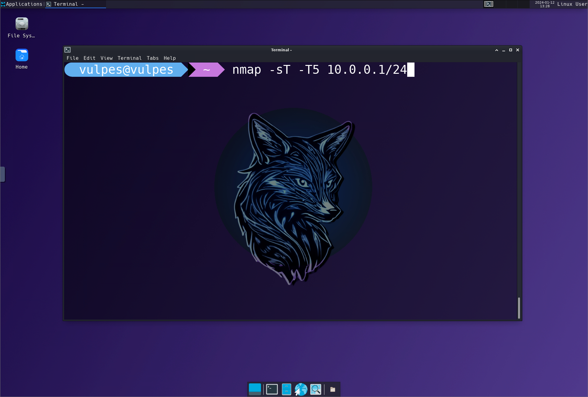

# Vulpes 🦊

All-in-one Docker-based workstation with hacking tools for Pentesting and offsec Labs, maintained by [@Fenrir.pro](https://github.com/fenrirsec).


Based on **Alpine Linux**, Vulpes is clutter-free, lightweight, and perfect for penetration testing, local training, workshops, and online classes on [hack.courses](https://hack.courses).

## Why? 🤔

We needed an efficient, hacking-oriented OS with a minimal CPU/RAM/storage footprint for on-demand online workstations. Unlike bulky systems like Kali and Ubuntu that take 20~30 minutes to set up, Vulpes deploys in under 20 seconds on Windows!

So, here's Vulpes! Oh, also, we added **encryption** of (potentially) hidden volumes in files with LUKS!

## Quick Setup ⚡

### On Windows?

```powershell
PS> docker-compose -f docker-compose-win-novnc.yml up
```

### On a UNIX-like system?

```bash
$> docker-compose -f docker-compose-unix-novnc.yml up
```

### If you chose the noVNC version

Once built (usually in 10 to 20 seconds), access Vulpes in your browser:

- **Locally**: http://127.0.0.1:8080/?path=127.0.0.1:6080
- **On a server/remote machine**: http://YOUR_SERVER_IP:8080/?path=YOUR_SERVER_IP:6080

> **IMPORTANT**: The default configuration exposes ports 8000 (noVNC web interface), 6080 (websockify), and 5900 (VNC) on 0.0.0.0.
> Ensure you trust machines on your local network (or change this setting) and **change the default VNC password** (currently *CHANGEME*) in the *docker-compose-win-novnc.yml* file.

### If you have your own VNC client

Using the VNC client of your choice, open the port **5900** (or ither if specified in your docker-compose file) on your local IP address, and voilà!

## Desktop tips 🖥️

- **Windows**: drag a title bar to the top edge to maximize, to the left or right edge to tile. Double-click a title bar to maximize or restore. Click a taskbar entry to focus or minimize a window, middle-click it to close.
- **Shortcuts**: browsers keep Ctrl+W, Ctrl+T and Ctrl+N for themselves. Use the full screen button in the top panel so remote apps receive them (hold Esc to leave full screen).
- **Clipboard**: paste with your usual shortcut, the text goes to the remote app. Text copied inside a remote app lands in your local clipboard.
- **macOS**: Cmd is sent as Ctrl, so Cmd+C / Cmd+V copy and paste in Linux apps. Option characters (|, {, ~...) are typed as-is.
- **Stream statistics**: toggle them in Settings, or press Ctrl+Alt+Shift+S inside an app window.

### Display streaming settings

`vulpes/WebOS/settings.json` configures WebX11:

| Key | Meaning |
| --- | --- |
| `max_width`, `max_height` | Largest size a window can reach (framebuffer size, ~33 MB per window at 3840x2160) |
| `max_fps` | Frame rate while something changes on screen (it drops to 6 fps when idle) |
| `image_quality` | JPEG quality for large changed areas |
| `lossless_max_area` | Changed areas up to this many pixels are sent as PNG (crisp text) |
| `lossless_refresh_ms` | When the screen is idle this long, JPEG areas are re-sent lossless |

Framebuffers live in `/dev/shm`, which is why `docker-compose.yml` sets `shm_size`.

## Screenshots 📸



## Current Goals 🎯

- Keep the distribution lightweight, ensuring it builds in under a minute with a standard network connection.
- Integrate all tools needed for our training sessions.

## Default Toolset 🛠️

- Wireshark
- nmap
- radare2
- netcat
- socat
- John the Ripper

## Installing tools

To keep the base image small and fast to build, extra tools are installed on
demand with [VulPKG](https://github.com/FenrirSec/vulpkg), the native package
manager. Each tool is a `.vulpkg` file (apk deps + an install script, and a
`.desktop` entry for GUI apps so they appear in the launcher). Packages live in
the mounted `./vulpkg` folder (`/var/lib/vulpkg/repo` in the container).

```bash
vulpkg available              # list everything you can install (no root needed)
sudo vulpkg install recon     # install a whole bundle
sudo vulpkg install vscode    # or a single tool
vulpkg list                   # what's installed
sudo vulpkg remove vscode
```

Installing needs root (`sudo`); listing does not. Binaries land in
`/usr/local/bin` (on `$PATH`); GUI tools show up in the app launcher. Add your
own by dropping a `.vulpkg` file in `./vulpkg` (see the VulPKG README for the
format).

**Bundles**

- `recon` - subfinder, httpx, dnsx, naabu, katana, gau, gobuster, nuclei, gowitness, dalfox
- `ad` - netexec, impacket, bloodhound-python, certipy, kerbrute, responder

**Recon / web**

- subfinder, httpx, dnsx, naabu, katana (ProjectDiscovery)
- amass, gau, gobuster, feroxbuster, gowitness
- nuclei, dalfox, sqlmap, ffuf, dirb, nikto, wpscan

**Active Directory / internal**

- netexec (the maintained CrackMapExec successor), impacket, crackmapexec
- bloodhound-python, certipy, kerbrute, responder, enum4linux-ng

**Passwords / cracking**

- hashcat, hydra, john (default), searchsploit

**C2 / proxies / editors / misc**

- sliver, villain, metasploit, mitmproxy, trufflehog, masscan
- burpsuite, vscode, forensics, ssh, encrypted-luks-volume
- seclists (wordlists at `/usr/share/seclists`)

Run `vulpkg available` on the box for the authoritative, up-to-date set.

Dive in and hack away! 🚀
