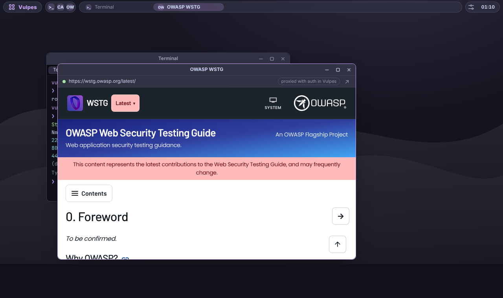
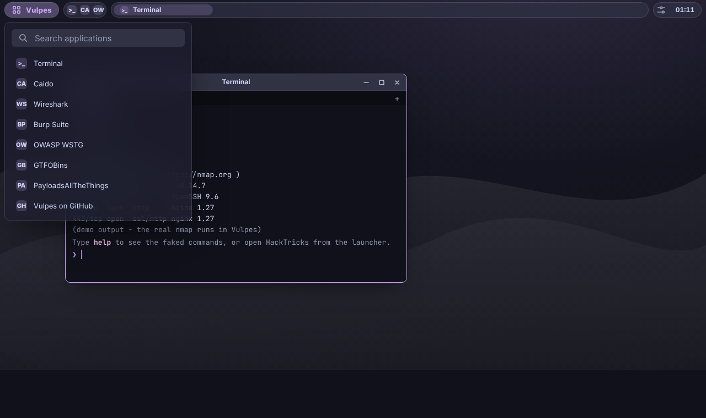
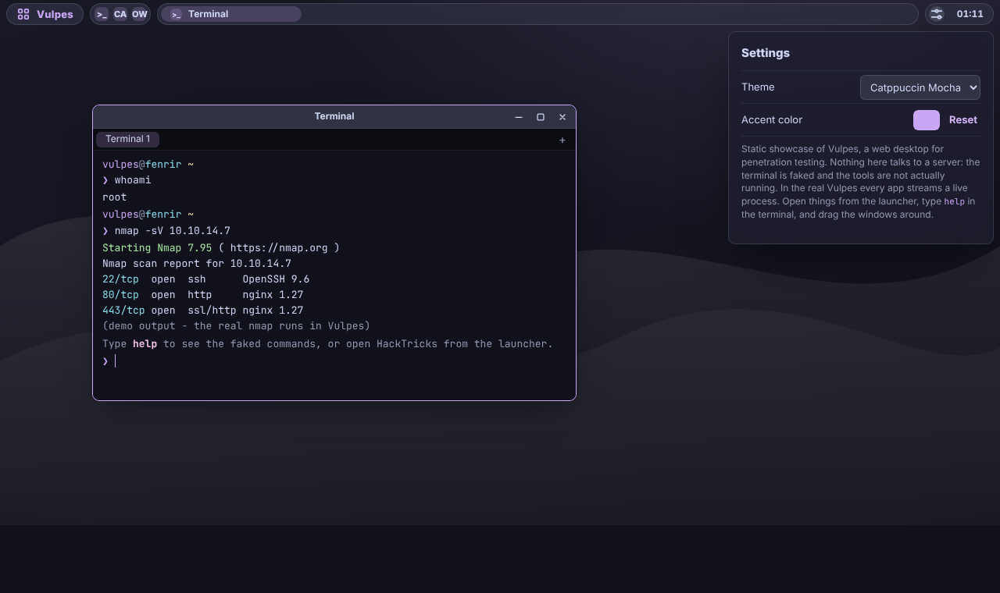
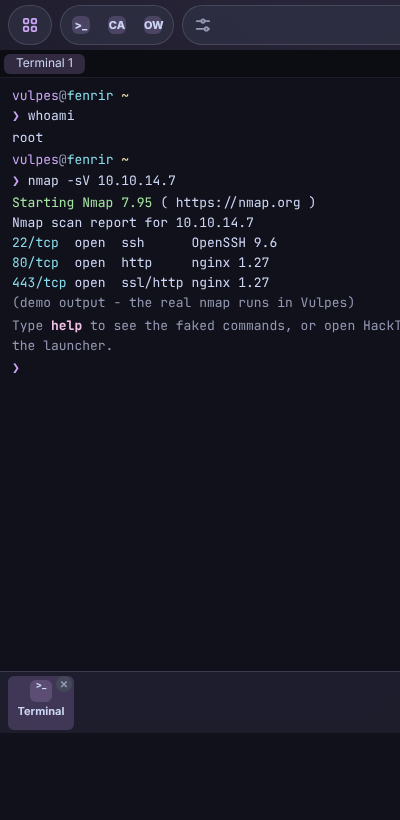

# Vulpes 🦊

All-in-one Docker-based workstation with hacking tools for Pentesting and offsec Labs, maintained by [@Fenrir.pro](https://github.com/fenrirsec).


Based on **Alpine Linux**, Vulpes is clutter-free, lightweight, and perfect for penetration testing, local training, workshops, and online classes on [hack.courses](https://hack.courses).

## Status and disclaimer ⚠️

Vulpes is a **work in progress and is not production ready**. It is a pentest WebOS, not a hardened, 100% secure operating system, exactly like most other pentest distributions (Kali, Parrot, and friends): the tooling it ships is offensive by nature and the desktop is built for convenience, not for standing on the open internet. At Fenrir.pro we run it on **closed, isolated environments that are not exposed to the WAN**, and we strongly advise you to do the same. It comes with **no warranty** of any kind, express or implied. Use it at your own risk.

## Why? 🤔

We needed an efficient, hacking-oriented OS with a minimal CPU/RAM/storage footprint for on-demand online workstations. Unlike bulky systems like Kali and Ubuntu that take 20~30 minutes to set up, Vulpes deploys in under 20 seconds on Windows!

So, here's Vulpes! Oh, also, we added **encryption** of (potentially) hidden volumes in files with LUKS!

## How it works: X11 in your browser 🖥️➡️🌐

Vulpes runs a full Linux desktop inside the container and **forwards X11 straight to
your browser** with **WebX11**: every graphical tool renders on a virtual X display
and is streamed over WebSockets into a window on the web desktop, fully interactive
(mouse, keyboard and clipboard). There is **no VNC, no noVNC and no extra client to
install** anymore: all you need is a browser.

## Quick Setup ⚡

```bash
docker compose up --build
```

Once built (usually in 10 to 20 seconds), open the web desktop in your browser:

- **http://127.0.0.1:8002/** and log in.

Credentials come from the `PASSWORD` environment variable in `docker-compose.yml`
(`vulpes123` out of the box). The compose file maps these host ports:

| Host port | Container | What |
| --- | --- | --- |
| `8002` | `80` | the Vulpes web desktop (nginx) |
| `2222` | `22` | SSH into the box |
| `8083` | `8083` | Caido |

> **Change the default `PASSWORD`** in `docker-compose.yml` before running Vulpes
> anywhere, and re-read the disclaimer above: keep it on a closed, isolated network,
> never exposed to the WAN.

## Desktop tips 🖥️

- **Windows**: drag a title bar to the top edge to maximize, to the left or right edge to tile. Double-click a title bar to maximize or restore. Click a taskbar entry to focus or minimize a window, middle-click it to close.
- **Shortcuts**: browsers keep Ctrl+W, Ctrl+T and Ctrl+N for themselves. Use the full screen button in the top panel so remote apps receive them (hold Esc to leave full screen).
- **Clipboard**: paste with your usual shortcut, the text goes to the remote app. Text copied inside a remote app lands in your local clipboard.
- **macOS**: Cmd is sent as Ctrl, so Cmd+C / Cmd+V copy and paste in Linux apps. Option characters (|, {, ~...) are typed as-is.
- **Stream statistics**: toggle them in Settings, or press Ctrl+Alt+Shift+S inside an app window.

### Display streaming settings

`vulpes/WebOS/settings.json` configures WebX11:

| Key | Meaning |
| --- | --- |
| `max_width`, `max_height` | Largest size a window can reach (framebuffer size, ~33 MB per window at 3840x2160) |
| `max_fps` | Frame rate while something changes on screen (it drops to 6 fps when idle) |
| `image_quality` | JPEG quality for large changed areas |
| `lossless_max_area` | Changed areas up to this many pixels are sent as PNG (crisp text) |
| `lossless_refresh_ms` | When the screen is idle this long, JPEG areas are re-sent lossless |

Framebuffers live in `/dev/shm`, which is why `docker-compose.yml` sets `shm_size`.

## Screenshots 📸

The desktop, with a terminal running and the themed wave background:



The application launcher and the settings panel (themes, accent colour, wallpaper, zoom and stream quality):




On a phone, apps go full screen and a bottom switcher moves between them:



Want to try the look and feel first? There is a **static, backend-free demo**:
**[try it live here](https://fenrirsec.github.io/vulpes/)** (or open
[`docs/index.html`](./docs/index.html) locally in any browser). The terminal takes a
handful of faked commands (`help`, `ls`, `nmap ...`, `vulpkg list`), the web tools
load for real, and the GUI apps explain how they stream in the full version. Nothing
talks to a server.

## Desktop features ✨

- **X11 app passthrough**: every graphical tool runs on a virtual X display inside the
  container and is streamed into a browser window over WebX11, fully interactive
  (mouse, keyboard and clipboard), with no VNC client to install.
- **Fully interactive, TTY-accurate terminal**: a real PTY streamed to the browser
  (not a half-emulated shell), with proper resize, colours, control sequences and a
  Catppuccin prompt, plus multiple tabs per window.
- **54 tools, one command each**: install any of 54 vulpkg packages and bundles with
  a single `vulpkg install <name>`.
- **Theming**: four built-in themes (Catppuccin Mocha, Latte, Nord, Gruvbox), an
  accent-colour picker, and a custom-CSS box so you can restyle anything. Sizes,
  padding and radii come from a small set of reused design tokens, so the whole
  desktop stays consistent.
- **Backgrounds**: pick a solid colour, paste an image URL, or upload a file. With
  no wallpaper set you get a themed gradient with a soft wave texture.
- **Per-window zoom / DPI**: scale app windows below or above 100% from Settings,
  handy on small or very high-resolution screens.
- **Stream quality**: trade sharpness for bandwidth on the fly; terminals re-fit and
  streamed apps reflow to the new scale.
- **Mobile layout**: on phones, apps run full screen with no title bar and a bottom
  app switcher for jumping between them.
- **Authenticated backends**: every backend route (the proxy, the WebX11 HTTP/WS
  endpoints, the terminal socket and the per-port apps) is gated behind the session
  cookie via nginx `auth_request`; only the login page is public.

## Current Goals 🎯

- Keep the distribution lightweight, ensuring it builds in under a minute with a standard network connection.
- Integrate all tools needed for our training sessions.

## Default Toolset 🛠️

- Wireshark
- nmap
- radare2
- netcat
- socat
- John the Ripper

## Installing tools

To keep the base image small and fast to build, extra tools are installed on
demand with [VulPKG](https://github.com/FenrirSec/vulpkg), the native package
manager. Each tool is a `.vulpkg` file (apk deps + an install script, and a
`.desktop` entry for GUI apps so they appear in the launcher). Packages live in
the mounted `./vulpkg` folder (`/var/lib/vulpkg/repo` in the container).

```bash
vulpkg available              # list everything you can install (no root needed)
sudo vulpkg install recon     # install a whole bundle
sudo vulpkg install vscode    # or a single tool
vulpkg list                   # what's installed
sudo vulpkg remove vscode
```

Installing needs root (`sudo`); listing does not. Binaries land in
`/usr/local/bin` (on `$PATH`); GUI tools show up in the app launcher. Add your
own by dropping a `.vulpkg` file in `./vulpkg` (see the VulPKG README for the
format).

**Bundles**

- `recon` - subfinder, httpx, dnsx, naabu, katana, gau, gobuster, nuclei, gowitness, dalfox
- `ad` - netexec, impacket, bloodhound-python, certipy, kerbrute, responder

**Recon / web**

- subfinder, httpx, dnsx, naabu, katana, tlsx (ProjectDiscovery)
- amass, gau, gobuster, feroxbuster, gowitness
- nuclei, dalfox, sqlmap, ffuf, dirb, dirsearch, nikto, wpscan
- arjun (parameter discovery), wafw00f (WAF fingerprinting)

**Active Directory / internal**

- netexec (the maintained CrackMapExec successor), impacket, crackmapexec
- bloodhound-python, certipy, kerbrute, responder, enum4linux-ng
- ncrack (network login cracking)

**Passwords / cracking / exploits**

- hashcat, hydra, john (default)
- searchsploit, sploitscan (CVE / exploit intel)

**Secrets / OSINT**

- gitleaks, trufflehog (secret scanning)
- theharvester (OSINT), interactsh-client (OOB interaction testing)

**C2 / proxies / scanners / editors / misc**

- sliver, villain, metasploit, mitmproxy
- masscan, rustscan (fast port scanning)
- burpsuite, caido-cli (modern web proxy), vscode
- forensics, ssh, encrypted-luks-volume, shellgpt
- seclists (wordlists at `/usr/share/seclists`)

Run `vulpkg available` on the box for the authoritative, up-to-date set (54 packages
and bundles today).

Dive in and hack away! 🚀
